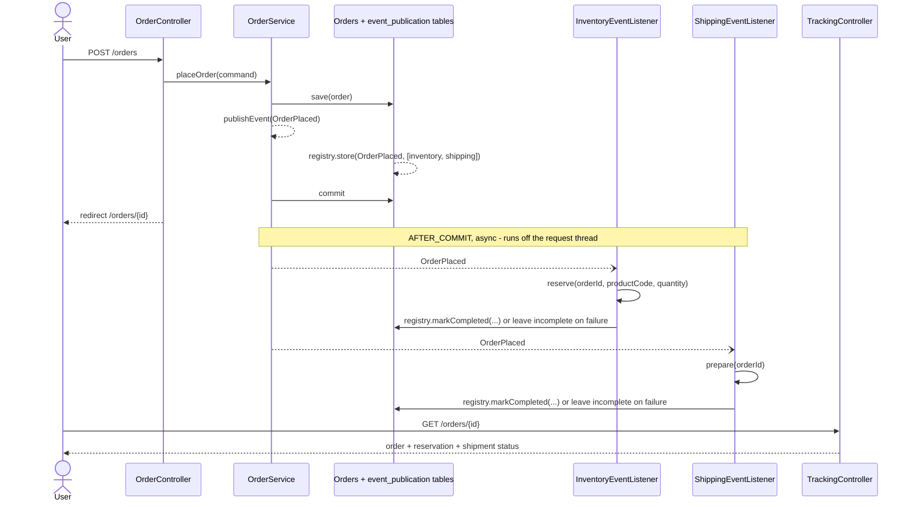

# order-placement-with-events

In-process domain events POC: placing an order publishes an event that inventory and shipping react to independently.

[](https://github.com/natsaros7/orderplacementwithevents/actions/workflows/ci.yml)

## What this POC demonstrates

- An `OrderService` that persists an order and publishes an `OrderPlaced` domain event in the same transaction.
- Two independent listeners (inventory, shipping) that react to that event without knowing about each other,
  via `@ApplicationModuleListener` — Spring Modulith's composition of `@Async` +
  `@TransactionalEventListener(phase = AFTER_COMMIT)` + `@Transactional(REQUIRES_NEW)`, so listeners only run
  once the order is durably committed, off the request thread, in their own transaction.
- A durable **event publication registry** (`spring-modulith-starter-jpa`, schema in Flyway): every
  `@ApplicationModuleListener` invocation is recorded; a listener that throws leaves its publication
  incomplete instead of the event being silently lost, and it gets resubmitted (on restart and on a
  schedule) until it completes — this is what closes the previous "event lost on crash" gap, see Design
  notes.
- Idempotent, per-feature persistence: each listener's side effect is safe to retry or redeliver.
- Four Spring Modulith application modules (`order`, `inventory`, `shipping`, `tracking`), each declaring
  its allowed dependencies in `package-info.java`; `ApplicationModules.of(...).verify()` enforces the
  dependency graph (no cycles, `order` depends on nothing) directly from that metadata instead of a
  separately maintained rule set.
- A dedicated `tracking` feature assembles the cross-feature read model (`OrderTrackingView`) from
  `order`, `inventory` and `shipping`'s narrow query services, so `order` itself stays unaware that
  inventory/shipping exist.



## Tech stack

| Component       | Version  |
|------------------|---------|
| Java             | 25      |
| Spring Boot      | 4.1.1   |
| Spring Framework | 7.x     |
| Spring Modulith  | 2.1.1 (`spring-modulith-bom`) |
| Hibernate ORM    | 7.x     |
| PostgreSQL       | 18 (`postgres:18` image; driver version managed by Boot BOM) |
| Flyway           | Boot-managed |
| Thymeleaf        | Boot-managed |
| JUnit 5 / Mockito / AssertJ | Boot-managed |
| Testcontainers (Postgres) | Boot-managed |
| Awaitility       | 4.x (Modulith-managed) |

## Prerequisites

- JDK 25 (see `.sdkmanrc`; `sdk env install` if using SDKMAN!)
- No local Maven needed — use the bundled wrapper (`./mvnw`)
- Docker (or Docker Desktop/colima with `DOCKER_HOST`/`TESTCONTAINERS_DOCKER_SOCKET_OVERRIDE` set accordingly) —
  required for the Postgres container, both via `compose.yaml` to run the app and via Testcontainers to run
  the test suite

## Build & test

Tests use Testcontainers, so Docker must be running (see "Prerequisites"). On macOS with
[colima](https://github.com/abiosoft/colima) instead of Docker Desktop, export `DOCKER_HOST` to colima's
socket and `TESTCONTAINERS_DOCKER_SOCKET_OVERRIDE=/var/run/docker.sock` before running Maven.

```bash
# Full build: compile, unit + slice tests, integration tests, JaCoCo report
./mvnw clean verify

# Unit and slice tests only (excludes *IT)
./mvnw test

# A single test class
./mvnw test -Dtest=OrderServiceTest

# Coverage report (after a build that ran tests)
open target/site/jacoco/index.html
```

`compose.yaml` only defines Postgres — it's the dev-time database, not an app container (the Dockerfile stays a
standalone app image per the "Database" section of the gap-closing spec).

```bash
# Via the wrapper — spring-boot-docker-compose auto-starts/stops compose.yaml's Postgres container
./mvnw spring-boot:run

# Via the packaged jar — same auto-start behaviour
./mvnw clean package -DskipTests
java -jar target/order-placement-with-events-0.0.1-SNAPSHOT.jar

# Postgres only, e.g. to point a separately built app container at it
docker compose up -d --wait
docker compose down -v

# The app's own Docker image needs DB_URL (and DB_USER/DB_PASSWORD if not using the defaults) pointed at
# a reachable Postgres — e.g. compose's, via the host gateway:
docker build -t order-placement-with-events .
docker run -p 8080:8080 -e DB_URL=jdbc:postgresql://host.docker.internal:5432/orderplacement order-placement-with-events
```

Then open <http://localhost:8080>.

## Configuration

| Env var                   | Property                              | Default                                           | Purpose |
|----------------------------|----------------------------------------|----------------------------------------------------|---------|
| `DB_URL`                  | `spring.datasource.url`               | `jdbc:postgresql://localhost:5432/orderplacement`  | Postgres JDBC URL |
| `DB_USER`                  | `spring.datasource.username`          | `orderplacement`                                   | Postgres username |
| `DB_PASSWORD`              | `spring.datasource.password`          | `orderplacement`                                   | Postgres password |
| `ASYNC_POOL_CORE_SIZE`     | `spring.task.execution.pool.core-size`| `4`                                                | Async executor core pool size |
| `ASYNC_POOL_MAX_SIZE`      | `spring.task.execution.pool.max-size` | `8`                                                | Async executor max pool size |
| `ASYNC_POOL_QUEUE_CAPACITY`| `spring.task.execution.pool.queue-capacity` | `50`                                         | Async executor queue capacity |
| `EVENTS_REPUBLISH_ON_RESTART` | `spring.modulith.events.republish-outstanding-events-on-restart` | `true` | Resubmit incomplete publications found at startup |
| `EVENT_RESUBMISSION_INTERVAL` | `app.events.resubmission.interval`  | `PT1M`                                             | How often `StaleEventPublicationResubmitter` runs |
| `EVENT_RESUBMISSION_MIN_AGE`  | `app.events.resubmission.min-age`   | `PT5M`                                             | How old an incomplete publication must be before it's resubmitted |
| `SERVER_PORT`              | `server.port`                         | `8080`                                             | HTTP port |

Schema is managed entirely by Flyway (`spring.jpa.hibernate.ddl-auto: validate`), including Spring
Modulith's event publication registry tables; migrations live in `src/main/resources/db/migration`. The
defaults above match `compose.yaml`, so `./mvnw spring-boot:run` works out of the box with no environment
variables set.

## Endpoints / UI

| Method | Path             | Purpose |
|--------|------------------|---------|
| GET    | `/`              | Redirects to `/orders/new` |
| GET    | `/orders/new`    | Order placement form |
| POST   | `/orders`        | Places an order; PRG redirect to `/orders/{id}` on success, re-renders the form with errors otherwise |
| GET    | `/orders/{id}`   | Order status (order, inventory reservation, shipment); 404 page for an unknown id |
| GET    | `/actuator/health` | Overall health |
| GET    | `/actuator/health/liveness` | Liveness probe |
| GET    | `/actuator/health/readiness` | Readiness probe |
| GET    | `/actuator/info`   | Build/app info |

## Project structure

```
compose.yaml                         # Postgres only — auto-started by spring-boot-docker-compose
src/main/resources/db/migration/     # Flyway migrations: V1 schema, V2 event_publication(_archive) + widen product_code
src/main/java/org/poc/orderplacement/events/
├── OrderPlacementWithEventsApplication.java
├── AsyncConfig.java                  # @EnableAsync/@EnableScheduling + applicationTaskExecutor + exception logging
├── ClockConfig.java                  # Single injectable Clock bean
├── EventResubmissionProperties.java  # app.events.resubmission.* (@ConfigurationProperties)
├── StaleEventPublicationResubmitter.java # @Scheduled: resubmits incomplete publications older than min-age
├── order/                            # @ApplicationModule(allowedDependencies = {}) — knows nothing about the others
│   ├── package-info.java, Order.java, OrderStatus.java, OrderRepository.java
│   ├── PlaceOrderCommand.java, OrderPlaced.java, OrderService.java
│   ├── OrderSummary.java, OrderQueryService.java      # narrow public query surface
│   └── web/ (OrderController: GET /orders/new, POST /orders)
├── inventory/                        # @ApplicationModule(allowedDependencies = "order")
│   ├── package-info.java, InventoryReservation.java, InventoryReservationRepository.java
│   ├── InventoryService.java, InventoryEventListener.java, InventoryQueryService.java
├── shipping/                         # @ApplicationModule(allowedDependencies = "order")
│   ├── package-info.java, Shipment.java, ShipmentRepository.java
│   ├── ShippingService.java, ShippingEventListener.java, ShippingQueryService.java
└── tracking/                         # @ApplicationModule(allowedDependencies = {"order","inventory","shipping"})
    ├── package-info.java, OrderTrackingView.java, OrderTrackingService.java, OrderNotFoundException.java
    └── web/ (HomeController, TrackingController: GET /orders/{id}, TrackingWebExceptionHandler)

src/test/java/org/poc/orderplacement/events/
├── TestcontainersConfiguration.java  # Shared, JVM-wide Postgres container (@ServiceConnection) for ITs/@DataJpaTest
├── ModularityTests.java              # ApplicationModules.verify() + Documenter (diagrams under target/, not committed)
├── EventPublicationRegistryIT.java   # failed listener -> incomplete publication -> resubmit -> complete
└── EventPublicationRestartRecoveryIT.java # same, but via a second ApplicationContext (simulated restart)
```

## Design notes & trade-offs

| Decision | Why | Trade-off |
|---|---|---|
| In-process `ApplicationEventPublisher` + plain record events | Simplest way to decouple inventory/shipping from order placement in a single-process POC | No cross-process delivery, no durability beyond the JVM — contrast with [orderplacementwithqueue](https://github.com/natsaros7/orderplacementwithqueue) (same domain over JMS) |
| `@ApplicationModuleListener` (= `@Async` + `@TransactionalEventListener(AFTER_COMMIT)` + `@Transactional(REQUIRES_NEW)`) | Listeners never see an order that later rolls back, don't block `POST /orders`, and can't roll back the order or each other; one annotation instead of hand-stacking three | Failures still only surface via the event publication registry/logs, not to the original caller |
| Event publication registry (`spring-modulith-starter-jpa`) + `completion-mode: archive` | Every listener invocation is durably recorded (`event_publication` table); a failure leaves the publication incomplete instead of the event vanishing, closing the previous "lost on crash" gap. `archive` (vs `update`/`delete`) keeps the active table small for staleness scans while preserving a full audit trail in `event_publication_archive` | A second table with the same shape to maintain; `update` would be simpler (one table) but grow forever, `delete` would be leanest but lose the audit trail entirely |
| `republish-outstanding-events-on-restart=true` + `StaleEventPublicationResubmitter` (`@Scheduled`) | Two independent safety nets: outstanding publications are resubmitted once at every startup (covers the crash-and-restart case), and a scheduled sweep resubmits anything still incomplete after `min-age` (covers a transient failure with no restart) | `republish-outstanding-events-on-restart` is explicitly not recommended by Modulith for multi-instance deployments (every instance would resubmit); a single-instance POC assumption |
| `@Transactional(REQUIRES_NEW)` kept on `InventoryService.reserve`/`ShippingService.prepare`, nested inside the listener's own REQUIRES_NEW | `saveAndFlush` throwing marks whichever transaction is active as rollback-only; since the listener catches that exception inside its own (now REQUIRES_NEW-sourced-from-`@ApplicationModuleListener`) transactional method, an inner REQUIRES_NEW is required so the exception-and-rollback happens cleanly in a nested transaction instead of poisoning the listener's, which would otherwise fail to commit with `UnexpectedRollbackException` on normal return | Two nested transactions per listener invocation instead of one; a direct, reproducible consequence of moving the transactional boundary to `@ApplicationModuleListener` — verified by removing it and watching the ITs fail with exactly that exception |
| `CallerRunsPolicy` on the async executor (`ThreadPoolTaskExecutorCustomizer`) | The order is already committed by the time an `AFTER_COMMIT` listener runs; rejecting a saturated submission back to the caller would surface as a 500 for an order that already succeeded, and risks a retry creating a duplicate order | Under sustained saturation, the submitting thread runs the listener synchronously — added request latency instead of a dropped/rejected task |
| IDs (not entities) in `OrderPlaced` | Listeners can't accidentally touch detached JPA state or create implicit coupling to the `order` schema | Listeners that need more order data must query for it themselves |
| Idempotent on `orderId` (unique column + exists-check, violation caught at the listener) | Safe against retry and concurrent redelivery without a dedup table | The exists-check only narrows the race window; the unique constraint (surfaced via `saveAndFlush`) is still the real guarantee |
| A separate `tracking` feature owns the read model | `order` exposes only `OrderQueryService`/`OrderSummary` and never imports `inventory`/`shipping`; `tracking` is the single place allowed to depend on all three. No package cycle: `tracking` → {`order`,`inventory`,`shipping`}; `inventory`/`shipping` → `order` (event type only) | One more package/feature for what's conceptually a simple read model; justified once two reactors need combining without coupling them to each other |
| Spring Modulith `@ApplicationModule`/`ApplicationModules.verify()` instead of the hand-rolled ArchUnit test | The same invariants (no cycles, `order` isolated) now come directly from `package-info.java` metadata the modules already need to declare, rather than a separately maintained ArchUnit rule set that could drift from it; also gets module docs/diagrams (`Documenter`) for free | One more dependency (`spring-modulith-core`, pulled transitively, still ArchUnit-based under the hood) instead of a dependency we controlled directly |
| PostgreSQL + Flyway, `ddl-auto: validate` | A single real schema the app, tests and migrations all agree on; Flyway migrations are the only thing allowed to change the schema, removing the H2-vs-production-DB dialect gap entirely | One more moving part for local dev (a running Postgres) versus H2's zero-setup in-memory default |
| `spring-boot-docker-compose` + a Postgres-only `compose.yaml` | `./mvnw spring-boot:run` "just works" without the developer hand-starting a container; auto-stops on shutdown too | Only wires up for local dev/`spring-boot:run` — the app's own Dockerfile image still expects Postgres to be reachable externally (`DB_URL` etc.); the two are deliberately not the same compose file |
| Testcontainers (singleton Postgres container, `@ServiceConnection`) for `@DataJpaTest`/ITs | Tests run against the real engine (types, constraints, enum-as-check-constraint) instead of an H2 compatibility-mode approximation | Every test run now needs Docker; CI runners have it, local dev needs colima/Docker Desktop running first |

## Known gaps / next steps

- **No max-attempts/backoff on resubmission**: `StaleEventPublicationResubmitter` retries forever at a
  fixed interval; a permanently-failing listener (e.g. a bad event payload) will be retried indefinitely
  with no dead-letter equivalent, no alerting, and no visibility beyond log lines and manually querying
  `event_publication`/`event_publication_archive`.
- **Registry/staleness metrics aren't surfaced**: Modulith's 2.1 staleness-detection properties
  (`spring.modulith.events.staleness.*`) aren't configured here; wiring them up, plus exposing
  pending/completed publication counts via Micrometer, would make the registry observable instead of
  something you only inspect by querying the database directly.
- **`republish-outstanding-events-on-restart` assumes a single instance**: Modulith's own docs call out
  that this isn't recommended for multi-instance deployments (every instance would resubmit the same
  outstanding publications on its own startup) — fine for this POC, a real deployment would need a
  leader-election or single-resubmitter strategy.
- **Module API visibility isn't verified**: `ApplicationModules.verify()` checks the dependency graph
  (cycles, `order` isolation) but not that only the intended classes in each module are public — e.g.
  nothing stops a class in `order.web` from being made public and reached from another module directly.
- **Single process only**: compare with [orderplacementwithqueue](https://github.com/natsaros7/orderplacementwithqueue),
  which solves the same domain problem over JMS — durable, cross-process delivery, at the cost of needing a
  broker and explicit message contracts instead of in-process event types.
- No authentication/authorization; out of scope for this POC.
- **Single Postgres instance, no backup/HA story**: fine for a POC; a real deployment would need at least
  replication and a backup policy, neither of which `compose.yaml` attempts to demonstrate.

## License

MIT — see [LICENSE](LICENSE).
