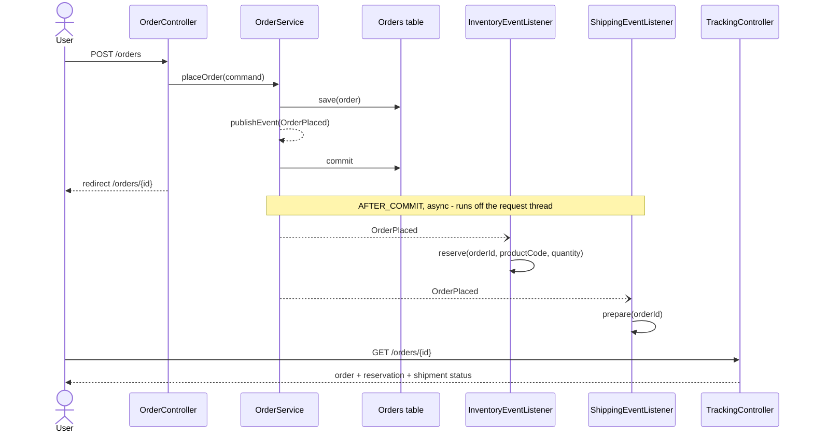

# order-placement-with-events

In-process domain events POC: placing an order publishes an event that inventory and shipping react to independently.

[](https://github.com/natsaros7/orderplacementwithevents/actions/workflows/ci.yml)

## What this POC demonstrates

- An `OrderService` that persists an order and publishes an `OrderPlaced` domain event in the same transaction.
- Two independent listeners (inventory, shipping) that react to that event without knowing about each other.
- `@TransactionalEventListener(phase = AFTER_COMMIT)` + `@Async`: listeners only run once the order is
  durably committed, off the request thread, in their own transaction.
- Idempotent, per-feature persistence: each listener's side effect is safe to retry or redeliver.
- A dedicated `tracking` feature assembles the cross-feature read model (`OrderTrackingView`) from
  `order`, `inventory` and `shipping`'s narrow query services, so `order` itself stays unaware that
  inventory/shipping exist. An ArchUnit test enforces this boundary (no package cycles; `order`
  depends on nothing else).



## Tech stack

| Component       | Version  |
|------------------|---------|
| Java             | 21      |
| Spring Boot      | 4.1.1   |
| Spring Framework | 7.x     |
| Hibernate ORM    | 7.x     |
| H2 (embedded)    | runtime-managed by Boot BOM |
| Thymeleaf        | Boot-managed |
| JUnit 5 / Mockito / AssertJ | Boot-managed |
| Awaitility       | 4.x     |
| ArchUnit         | 1.5.x   |

## Prerequisites

- JDK 21 (see `.sdkmanrc`; `sdk env install` if using SDKMAN!)
- No local Maven needed — use the bundled wrapper (`./mvnw`)
- Docker, only if you want to build/run the container image

## Build & test

```bash
# Full build: compile, unit + slice tests, integration tests, JaCoCo report
./mvnw clean verify

# Unit and slice tests only (excludes *IT)
./mvnw test

# A single test class
./mvnw test -Dtest=OrderServiceTest

# Coverage report (after a build that ran tests)
open target/site/jacoco/index.html
```

## Run locally

```bash
# Via the wrapper
./mvnw spring-boot:run

# Via the packaged jar
./mvnw clean package -DskipTests
java -jar target/order-placement-with-events-0.0.1-SNAPSHOT.jar

# Via Docker
docker build -t order-placement-with-events .
docker run -p 8080:8080 order-placement-with-events
```

Then open <http://localhost:8080>.

## Configuration

| Env var                   | Property                              | Default                                           | Purpose |
|----------------------------|----------------------------------------|----------------------------------------------------|---------|
| `DB_URL`                  | `spring.datasource.url`               | `jdbc:h2:mem:orderplacement;DB_CLOSE_DELAY=-1`     | H2 JDBC URL |
| `DB_USERNAME`              | `spring.datasource.username`          | `sa`                                               | H2 username |
| `DB_PASSWORD`              | `spring.datasource.password`          | (empty)                                            | H2 password |
| `JPA_DDL_AUTO`             | `spring.jpa.hibernate.ddl-auto`       | `update`                                           | Schema generation strategy — fine for the embedded H2 used here; if `DB_URL` is ever pointed at a persistent/shared database, override to `validate` and manage schema separately |
| `ASYNC_POOL_CORE_SIZE`     | `spring.task.execution.pool.core-size`| `4`                                                | Async executor core pool size |
| `ASYNC_POOL_MAX_SIZE`      | `spring.task.execution.pool.max-size` | `8`                                                | Async executor max pool size |
| `ASYNC_POOL_QUEUE_CAPACITY`| `spring.task.execution.pool.queue-capacity` | `50`                                         | Async executor queue capacity |
| `SERVER_PORT`              | `server.port`                         | `8080`                                             | HTTP port |

The `local` Spring profile additionally enables the H2 console at `/h2-console`.

## Endpoints / UI

| Method | Path             | Purpose |
|--------|------------------|---------|
| GET    | `/`              | Redirects to `/orders/new` |
| GET    | `/orders/new`    | Order placement form |
| POST   | `/orders`        | Places an order; PRG redirect to `/orders/{id}` on success, re-renders the form with errors otherwise |
| GET    | `/orders/{id}`   | Order status (order, inventory reservation, shipment); 404 page for an unknown id |
| GET    | `/actuator/health` | Overall health |
| GET    | `/actuator/health/liveness` | Liveness probe |
| GET    | `/actuator/health/readiness` | Readiness probe |
| GET    | `/actuator/info`   | Build/app info |

## Project structure

```
src/main/java/org/poc/orderplacement/events/
├── OrderPlacementWithEventsApplication.java
├── AsyncConfig.java                 # @EnableAsync + Boot's applicationTaskExecutor + exception logging
├── order/                           # Order aggregate, OrderPlaced event; knows nothing about the other features
│   ├── Order.java, OrderStatus.java, OrderRepository.java
│   ├── PlaceOrderCommand.java, OrderPlaced.java, OrderService.java
│   ├── OrderSummary.java, OrderQueryService.java      # narrow public query surface
│   └── web/ (OrderController: GET /orders/new, POST /orders)
├── inventory/                       # Reacts to OrderPlaced; owns its own table
│   ├── InventoryReservation.java, InventoryReservationRepository.java
│   ├── InventoryService.java, InventoryEventListener.java, InventoryQueryService.java
├── shipping/                        # Reacts to OrderPlaced; owns its own table
│   ├── Shipment.java, ShipmentRepository.java
│   ├── ShippingService.java, ShippingEventListener.java, ShippingQueryService.java
└── tracking/                        # Assembles the cross-feature read model; the only feature allowed to
    ├── OrderTrackingView.java, OrderTrackingService.java, OrderNotFoundException.java  # depend on order + inventory + shipping
    └── web/ (HomeController, TrackingController: GET /orders/{id}, TrackingWebExceptionHandler)
```

## Design notes & trade-offs

| Decision | Why | Trade-off |
|---|---|---|
| In-process `ApplicationEventPublisher` + plain record events | Simplest way to decouple inventory/shipping from order placement in a single-process POC | No cross-process delivery, no durability beyond the JVM — contrast with [orderplacementwithqueue](https://github.com/natsaros7/orderplacementwithqueue) (same domain over JMS) |
| `@TransactionalEventListener(phase = AFTER_COMMIT)` | Listeners never see an order that later rolls back | If the process crashes after commit but before the listener runs, the event is lost — see "Known gaps" |
| `@Async` listeners | Keeps `POST /orders` fast; inventory/shipping failures can't affect the HTTP response | Failures are only visible in logs (via `AsyncUncaughtExceptionHandler`), not to the caller |
| `Propagation.REQUIRES_NEW` per listener | One listener's failure/rollback can't affect the order or the other listener | Two extra connections/transactions per order; acceptable at POC scale |
| `CallerRunsPolicy` on the async executor (`ThreadPoolTaskExecutorCustomizer`) | The order is already committed by the time an `AFTER_COMMIT` listener runs; rejecting a saturated submission back to the caller would surface as a 500 for an order that already succeeded, and risks a retry creating a duplicate order | Under sustained saturation, the submitting thread runs the listener synchronously — added request latency instead of a dropped/rejected task |
| IDs (not entities) in `OrderPlaced` | Listeners can't accidentally touch detached JPA state or create implicit coupling to the `order` schema | Listeners that need more order data must query for it themselves |
| Idempotent on `orderId` (unique column + exists-check, violation caught at the listener) | Safe against retry and concurrent redelivery without a dedup table | The exists-check only narrows the race window; the unique constraint (surfaced via `saveAndFlush`) is still the real guarantee |
| A separate `tracking` feature owns the read model | `order` exposes only `OrderQueryService`/`OrderSummary` and never imports `inventory`/`shipping`; `tracking` is the single place allowed to depend on all three. No package cycle: `tracking` → {`order`,`inventory`,`shipping`}; `inventory`/`shipping` → `order` (event type only) | One more package/feature for what's conceptually a simple read model; justified once two reactors need combining without coupling them to each other |

## Known gaps / next steps

- **Lost events on crash**: an `AFTER_COMMIT` event that hasn't yet been delivered when the JVM dies is
  gone. [Spring Modulith](https://docs.spring.io/spring-modulith/reference/)'s event publication registry
  (or a hand-rolled outbox table) would persist the event alongside the order and replay it on restart.
- **Module boundaries are ArchUnit-enforced, not Modulith-enforced**: `ArchitectureTest` guards against
  package cycles and `order` depending on the other features, but it doesn't verify module API visibility
  (e.g. that only intended classes are public) or generate module documentation the way Spring Modulith's
  `ApplicationModules.verify()` / `@ApplicationModuleTest` would. Adopting Modulith is the natural next
  step once the feature count grows.
- **Single process only**: compare with [orderplacementwithqueue](https://github.com/natsaros7/orderplacementwithqueue),
  which solves the same domain problem over JMS — durable, cross-process delivery, at the cost of needing a
  broker and explicit message contracts instead of in-process event types.
- No authentication/authorization; out of scope for this POC.

## License

MIT — see [LICENSE](LICENSE).
